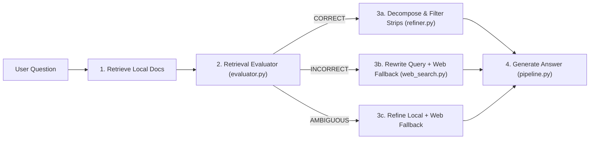

# Corrective RAG (CRAG)

Implementation of **Corrective Retrieval-Augmented Generation (CRAG)** (Yan et al., 2024), organized into one file per stage.

## How it works



## Files

| File | Role |
| --- | --- |
| [`evaluator.py`](./evaluator.py) | `RetrievalEvaluator`: grades each `(question, doc)` pair as `RELEVANT`, `PARTIAL`, or `IRRELEVANT` and outputs an overall verdict (`correct`, `ambiguous`, or `incorrect`). |
| [`refiner.py`](./refiner.py) | `KnowledgeRefiner`: decomposes documents into sentence strips, filters out off-topic sentences (such as boilerplate or noise), and recomposes clean strips. |
| [`web_search.py`](./web_search.py) | `WebSearchFallback`: rewrites the user question into a short search query and searches an external fallback corpus (or a custom web search function). |
| [`pipeline.py`](./pipeline.py) | `CRAGPipeline`: wires Retrieve → Evaluate → Refine / Fallback → Generate and returns a `CRAGResponse` with the full trace. |
| [`example.py`](./example.py) | Runnable demo showing both the `CORRECT` path (with sentence-level noise stripping) and the `INCORRECT` path (query rewrite + fallback search). |

## Run the example

```bash
python -m crag.example
```

