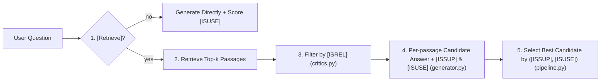

# Self-RAG (Self-Reflective Retrieval-Augmented Generation)

Implementation of **Self-RAG** (Asai et al., 2023), where the system critiques both its retrieval and its own generated answers using explicit **reflection tokens**.

## Reflection tokens

| Token | Question it asks | Values |
| --- | --- | --- |
| `[Retrieve]` | Does this question even need external retrieval? | `yes` / `no` |
| `[ISREL]` | Is the retrieved passage relevant to the question? | `relevant` / `irrelevant` |
| `[ISSUP]` | Are the claims in the candidate answer supported by the passage? | `fully_supported` / `partially_supported` / `no_support` |
| `[ISUSE]` | How useful and complete is the candidate answer overall? | `1` to `5` |

## How it works



## Files

| File | Role |
| --- | --- |
| [`critics.py`](./critics.py) | `SelfRAGCritics`: evaluates `[Retrieve]`, `[ISREL]`, `[ISSUP]`, and `[ISUSE]`. |
| [`generator.py`](./generator.py) | `SelfRAGGenerator`: drafts a candidate answer per relevant passage, pairs it with its reflection scores, and ranks candidates by `(support, utility)`. |
| [`pipeline.py`](./pipeline.py) | `SelfRAGPipeline`: orchestrates on-demand retrieval, passage filtering, candidate self-critique, optional query-rewrite retry, and final selection. |
| [`example.py`](./example.py) | Runnable demo showing both `[Retrieve] = YES` (with per-passage `[ISREL]`, `[ISSUP]`, `[ISUSE]` scores) and `[Retrieve] = NO` (direct answer for simple math). |

## Run the example

```bash
python -m self_rag.example
```

